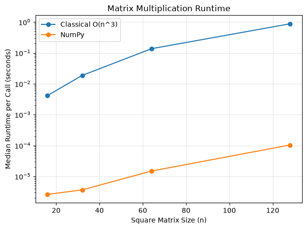
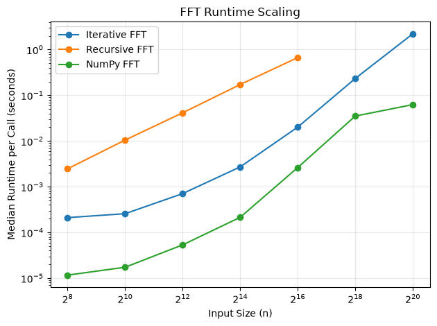
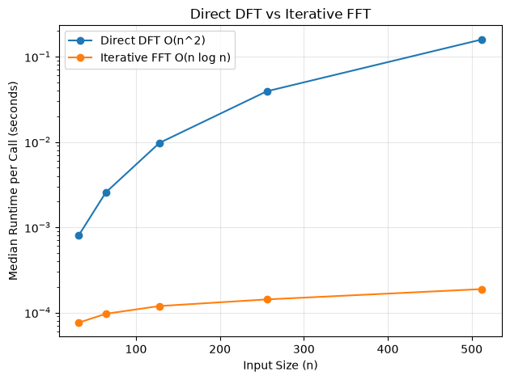
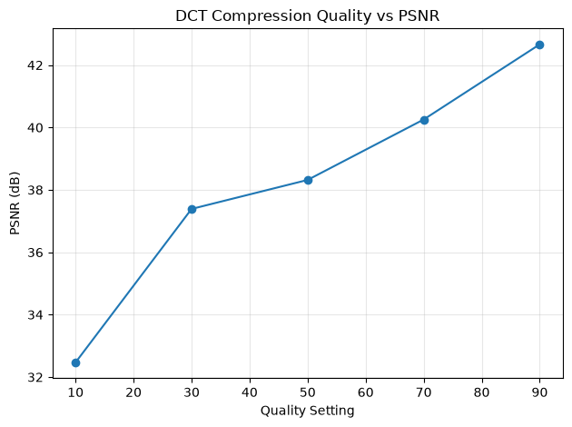
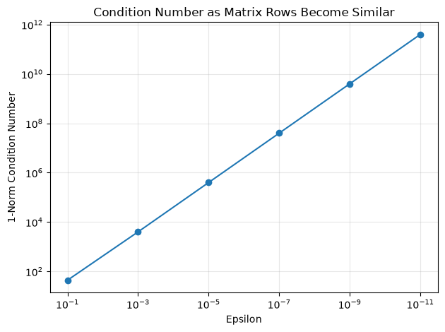

\# Chapter 12 Matrix, Numerical Algorithms, and FFT Analysis Report

\## Executive Summary

This project developed an `FFTAnalyzer` toolkit that combines numerical linear algebra, Fast Fourier Transform algorithms, signal processing, image processing, and time-series analysis. The main goal was to implement the important algorithms directly instead of relying on NumPy to perform the core work. NumPy was mainly used for arrays and as a reference for testing correctness.

The project includes classical matrix multiplication, LUP decomposition with partial pivoting, Householder QR decomposition, linear-system solving, determinant calculation, power iteration, numerical error measurements, condition-number estimation, recursive and iterative FFT algorithms, inverse FFT, convolution, signal filtering, spectral analysis, image filtering, DCT compression, audio processing, and time-series analysis.

Testing was an important part of the project. The completed Week 12 test suite contains 360 passing tests. Benchmarking also showed that the iterative FFT handled an input of 1,048,576 values in 2.214148 seconds while maintaining a maximum difference of only (4.479 \\times 10^{-12}) compared with NumPy's FFT.

\## Numerical and Matrix Algorithms

The matrix section began with classical matrix multiplication using three nested loops. Its time complexity is (O(n^3)), which agrees with the standard matrix multiplication algorithm covered in the course reading. I intentionally kept the implementation straightforward so the actual multiplication process could be seen rather than hiding it inside `numpy.matmul`.

LUP decomposition was implemented using partial pivoting. The matrix is decomposed into a permutation matrix (P), lower triangular matrix (L), and upper triangular matrix (U), where (PA = LU). Partial pivoting improves stability by selecting a larger available pivot instead of always using the current diagonal entry. Once the decomposition is available, forward and back substitution are used to solve linear systems.

QR decomposition was implemented with Householder reflections rather than classical Gram-Schmidt. I selected Householder QR because the reading identifies it as the more numerically stable approach. Tests verified both reconstruction of the original matrix and the orthogonality of (Q).

The power method was also implemented to approximate the dominant eigenvalue and eigenvector. This provided a practical example of an iterative numerical algorithm and was later reused when estimating the spectral norm for condition-number calculations.

The classical multiplication benchmark showed the expected increase in runtime as matrix size increased. A 16x16 multiplication took 0.004155 seconds, while a 128x128 multiplication took 0.874833 seconds. Numerical differences from NumPy stayed extremely small, ranging from approximately (2.22 \\times 10^{-15}) to (1.78 \\times 10^{-14}).

NumPy was thousands of times faster in several tests because its matrix operations execute in optimized compiled numerical libraries, while my implementation executes explicit Python loops. This comparison demonstrates the practical importance of optimized implementations, but it does not mean that the mathematical complexity of normal matrix multiplication changes.

\## FFT and Spectral Analysis

The project includes both recursive and iterative radix-2 Cooley-Tukey FFT implementations. The recursive version follows the divide-and-conquer structure directly by separating the input into even and odd positions and recursively solving smaller transforms. The iterative version performs a bit-reversal permutation first and then builds the result through butterfly stages.

Both implementations have (O(n \\log n)) theoretical complexity, compared with (O(n^2)) for the direct DFT. The iterative version was much faster in Python because it avoids the large amount of function-call and temporary-array overhead created by recursion.

The official benchmark showed the iterative FFT completing 256 values in 0.000212 seconds, 65,536 values in 0.020168 seconds, and 1,048,576 values in 2.214148 seconds. Maximum error compared with NumPy remained very small even at the largest size.

The direct DFT comparison demonstrated the complexity difference even more clearly. At only 32 values, the FFT was about 10.62 times faster. At 128 values it was 81.91 times faster, and at 512 values it was approximately 844.71 times faster. The direct DFT required 0.158948 seconds at 512 values while the iterative FFT required only 0.000188 seconds.

The FFT was then used for linear and circular convolution. Linear convolution was implemented by zero-padding both signals, multiplying their frequency-domain representations, and applying the inverse FFT. This same frequency-domain idea was extended into low-pass, high-pass, and band-pass filters.

Signal-analysis features include periodograms, power spectral density, peak-frequency detection, and STFT spectrograms. Signal generators were also implemented for sine waves, multi-tone signals, chirps, white noise, and approximate pink noise. These components made it possible to test filters against signals with known frequencies.

\## Image and Audio Applications

The image section extends the one-dimensional FFT into two dimensions by transforming each row and then each column. This 2D FFT is used for Gaussian blur, frequency-domain denoising, sharpening, and Sobel and Laplacian edge operations.

Image compression uses an 8x8 two-dimensional DCT with JPEG-style quantization. Lower quality settings use stronger quantization and produce more zero coefficients, while higher settings preserve more information.

The compression benchmark showed this tradeoff clearly. At quality 10, 97.357% of the coefficients became zero, but reconstruction error was higher with an MSE of 36.846 and PSNR of 32.467 dB. At quality 90, the zero percentage decreased to 82.556%, while MSE improved to 3.522 and PSNR increased to 42.663 dB.

This demonstrates why transform compression is effective. A large amount of image information can be represented by a relatively small number of important coefficients, while less important high-frequency information can be reduced more aggressively.

The audio application loads WAV files, converts stereo audio to mono when necessary, applies FFT-based filters, generates spectrogram data, detects dominant frequencies, and writes the processed audio back to a WAV file.

\## Numerical Stability and Conditioning

Numerical stability was another major focus of the project. Utilities were implemented for absolute and relative error, L1, L2, and infinity norms, residual error, condition-number estimation, and catastrophic cancellation.

The conditioning experiment used matrices whose rows became increasingly similar:

\\\[

\\begin{bmatrix}

1 \& 1 \\\\

1 \& 1+\\epsilon

\\end{bmatrix}

\\]

As epsilon became smaller, the condition number increased rapidly. With (\\epsilon = 10^{-1}), the condition number was about 44.1. At (10^{-5}), it increased to approximately (4.0 \\times 10^5). At (10^{-11}), the condition number reached approximately (4.0 \\times 10^{11}) and crossed the project's ill-conditioned threshold of (10^{10}).

This experiment helped show that a correct algorithm alone is not enough in numerical computing. Small changes in data can produce large changes in output when the underlying problem is ill-conditioned. Techniques such as partial pivoting and Householder reflections are therefore important because numerical stability matters along with theoretical complexity.

\## Final Reflection

This project connected several topics that initially appeared separate. Matrix operations, FFT algorithms, signal filtering, image processing, audio analysis, and numerical stability all depend heavily on efficient mathematical computation.

The clearest performance result was the difference between the direct DFT and FFT. Their outputs were essentially the same numerically, but their runtimes became dramatically different as input size increased. The iterative FFT successfully processed more than one million values, which showed how much impact reducing an algorithm from (O(n^2)) to (O(n \\log n)) can have.

The matrix experiments showed another important lesson. Complexity analysis explains how an algorithm scales, but implementation details also matter. Pure Python matrix multiplication was far slower than optimized NumPy even though both produced nearly identical answers. Numerical algorithms also have to consider stability, conditioning, memory use, and hardware optimization.

Overall, this project provided a practical example of how advanced algorithms move from mathematical theory into real applications. The same underlying FFT and matrix concepts were reused for filtering, convolution, compression, spectral analysis, audio processing, image processing, and time-series analysis.

\## References

Amakobe, M. (2025). \*Advanced algorithms: Concepts, complexity, and applied projects\*. Chapter 12: Matrix \& Numerical Algorithms.

Cormen, T. H., Leiserson, C. E., Rivest, R. L., \& Stein, C. (2022). \*Introduction to algorithms\* (4th ed.). MIT Press.
