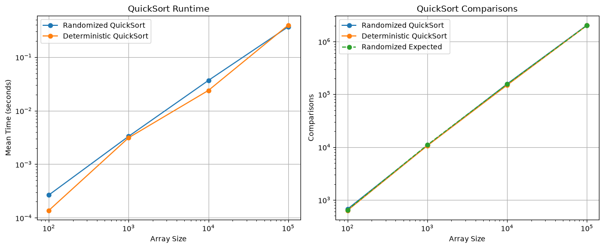
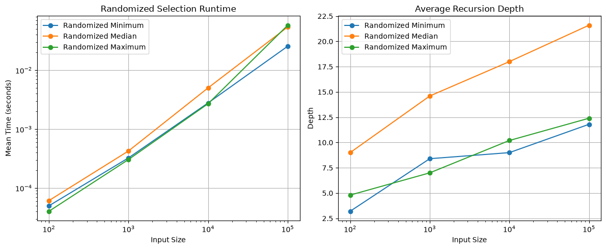
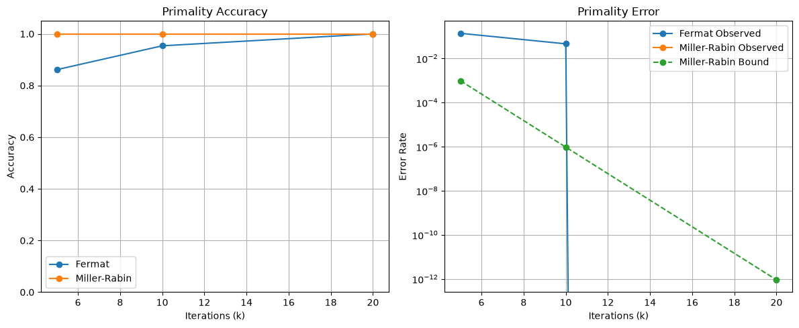
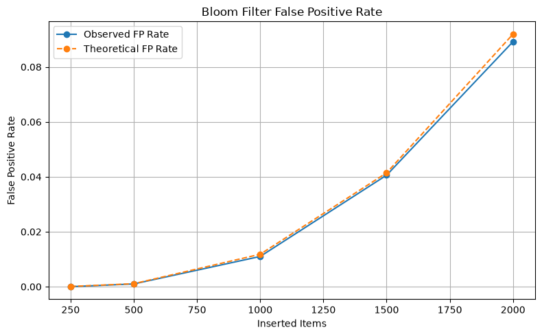
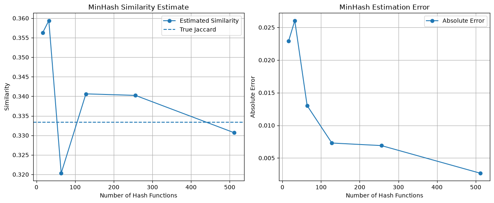

# Week 7 Randomized Algorithms Performance Report

Jaymes McKenzie

## Executive Summary

Week 7 focused on using randomness as part of algorithm design instead of treating it as something to avoid. The project compared deterministic and randomized approaches using QuickSort, QuickSelect, Monte Carlo primality testing, Bloom filters, and MinHash similarity estimation.

The results showed that randomized algorithms do not always run faster on every individual test, but they can provide better expected behavior and reduce the risk of consistently poor choices. At an input size of 100,000, Randomized QuickSort averaged about 0.368 seconds compared with 0.395 seconds for the deterministic baseline. Its measured comparison count of about 2.04 million was also close to the theoretical expectation of about 2.02 million.

Randomized QuickSelect returned the correct result in every trial. Miller-Rabin also achieved 100% observed accuracy at 5, 10, and 20 iterations, while Fermat testing improved from about 86% accuracy at five iterations to 100% at twenty. Bloom-filter measurements followed the theoretical false-positive rate closely, and MinHash estimates became more accurate as the number of hash functions increased.

## Methodology

The project was developed and benchmarked on Windows using Python 3.14.5. Pytest was used for automated testing, Pandas stored benchmark data, and Matplotlib generated the required visualizations.

Random seeds were used throughout the benchmark so that randomized experiments could be repeated. Randomized QuickSort was measured at array sizes of 100, 1,000, 10,000, and 100,000. Five trials were performed at each size. Because the existing Week 2 QuickSort already used randomized pivot selection, a separate deterministic final-element-pivot version was created as the Week 7 comparison baseline.

QuickSelect was tested at the same input sizes for minimum, median, and maximum selection. Runtime variance, recursion depth, and success rate were recorded.

Fermat and Miller-Rabin primality tests were evaluated using iteration counts of 5, 10, and 20. The test set included primes, normal composite numbers, and Carmichael numbers. Deterministic trial division was also measured on a prime larger than one million.

Bloom filters used 10,000 bits and four hash functions. The inserted item count ranged from 250 to 2,000, and 5,000 membership queries were used to measure false positives. MinHash was tested with signature sizes from 16 to 512 against two sets with a true Jaccard similarity of one-third.

## Results

### Randomized QuickSort

Randomized QuickSort showed expected O(n log n) behavior across the tested sizes. At 100 elements, its average runtime was about 0.000267 seconds. At 100,000 elements, the runtime increased to about 0.368 seconds.

The deterministic baseline was faster at 100, 1,000, and 10,000 elements on the shuffled benchmark data. At 100,000 elements, however, Randomized QuickSort was slightly faster, taking about 0.368 seconds compared with 0.395 seconds.

The comparison counts also matched theory reasonably well. At 100,000 elements, Randomized QuickSort averaged about 2,042,555 comparisons, while the theoretical expectation was about 2,018,053. Its average recursion depth was 41.

One important benefit of randomization is not simply that it always makes QuickSort faster. Instead, random pivot selection makes it much harder for a particular input pattern to consistently force poor partitions. A fixed final-element pivot can perform badly on ordered inputs, while randomization reduces the chance of repeatedly selecting an extreme pivot.

### Randomized Selection

Randomized QuickSelect produced the correct kth-smallest value in every benchmark trial, giving it a 100% success rate. This is an example of a Las Vegas randomized algorithm because randomness affects runtime and recursion behavior but not the correctness of the final answer.

At 100,000 elements, selecting the minimum took about 0.0255 seconds, the median took about 0.0542 seconds, and the maximum took about 0.0580 seconds. Average recursion depths at that size were 11.8 for the minimum, 21.6 for the median, and 12.4 for the maximum.

The results also showed that randomization does not guarantee the fastest individual run. The deterministic version was faster for some selections, while the randomized version was faster for others. The advantage is expected efficiency across varying inputs rather than a guarantee that every randomized execution will outperform a deterministic one.

### Monte Carlo Primality Testing

The primality results showed a clear difference between Fermat testing and Miller-Rabin. Fermat testing achieved about 86.15% accuracy with five iterations, 95.38% with ten iterations, and 100% with twenty iterations.

Miller-Rabin produced 100% observed accuracy at all three iteration counts. Its theoretical false-prime probability also decreased rapidly. At five iterations, the upper bound was approximately 0.0009766. At ten iterations it dropped to about 0.000000954, and at twenty iterations it became extremely small.

This difference is especially important because the benchmark included Carmichael numbers, which can fool Fermat's test. Miller-Rabin is more robust because its test conditions expose many composite numbers that satisfy Fermat's simpler congruence.

The deterministic trial-division check on 1,000,003 took about 0.000055 seconds. Probabilistic tests had very small average runtimes as well, demonstrating why probabilistic primality testing becomes attractive as numbers become larger.

### Bloom Filter

The Bloom filter demonstrated the trade-off between memory efficiency and certainty. With only 250 stored items, no false positives were observed, while the theoretical rate was about 0.000082.

As more items were added, the false-positive rate increased. At 1,000 items, the observed rate was 0.0110 compared with a theoretical rate of about 0.0118. At 1,500 items, the observed rate was 0.0406 compared with 0.0414 theoretically. At 2,000 items, the observed rate reached 0.0892, close to the expected 0.0920.

The bit-array load factor also increased from about 9.5% to 55.3%. These results show why Bloom filters are useful when saving memory is more important than absolute certainty. A negative result is reliable, while a positive result means the item may be present.

### MinHash Similarity

The true Jaccard similarity for the tested sets was 0.3333. With only 16 hash functions, MinHash estimated the similarity as 0.3563, giving an absolute error of about 0.0229.

The error did not decrease perfectly at every step because MinHash is probabilistic. For example, the 32-hash signature had slightly more error than the 16-hash version. However, the overall pattern improved as more hashes were used.

At 128 hashes, the error dropped to about 0.0073. At 256 hashes it was about 0.0069, and at 512 hashes it fell to about 0.0027. The cost was additional runtime, increasing from about 0.0106 seconds at 16 hashes to about 0.317 seconds at 512.

## Discussion

Week 7 showed an important difference between Las Vegas and Monte Carlo algorithms. Randomized QuickSort and QuickSelect always produce the correct result. Their randomness changes the path and expected runtime, so they are Las Vegas algorithms. Fermat and Miller-Rabin testing can return a probable-prime result for a composite number, making them Monte Carlo approaches.

Bloom filters and MinHash also accept controlled uncertainty. A Bloom filter saves space by allowing false positives, while MinHash reduces the cost of comparing large sets by estimating similarity instead of calculating it exactly.

This changes the way efficiency can be viewed. Deterministic algorithms provide repeatability and clear guarantees, but randomized algorithms can avoid bad input patterns, simplify some problems, or trade a very small probability of error for major gains in speed or memory.

These techniques are useful in areas such as cryptography, search systems, distributed databases, streaming analytics, and machine learning, where exact processing of every possible state may be too expensive.

## Conclusion

Week 7 completed the Core Techniques portion of the course by adding probability to the algorithm-design toolbox. The results showed that randomness is not the opposite of good design. It can be intentionally used to improve expected performance, avoid adversarial patterns, reduce memory use, and estimate answers efficiently.

Randomized QuickSort and QuickSelect showed how randomness can improve expected algorithm behavior without sacrificing correctness. Miller-Rabin demonstrated how a very small probability of error can provide efficient primality testing. Bloom filters showed a practical memory-versus-accuracy trade-off, while MinHash demonstrated how approximate similarity can improve as more randomized samples are used.

Overall, the project showed that modern algorithm design is not always about guaranteeing an exact path. Sometimes the better solution is to manage uncertainty carefully and use probability as part of the algorithm itself.

## References

Cormen, T. H., Leiserson, C. E., Rivest, R. L., & Stein, C. (2022). *Introduction to Algorithms* (4th ed.). MIT Press.

Amakobe, M. (2025). *Advanced Algorithms: A Journey Through Computational Problem Solving*. Chapter 6: Randomized Algorithms.
