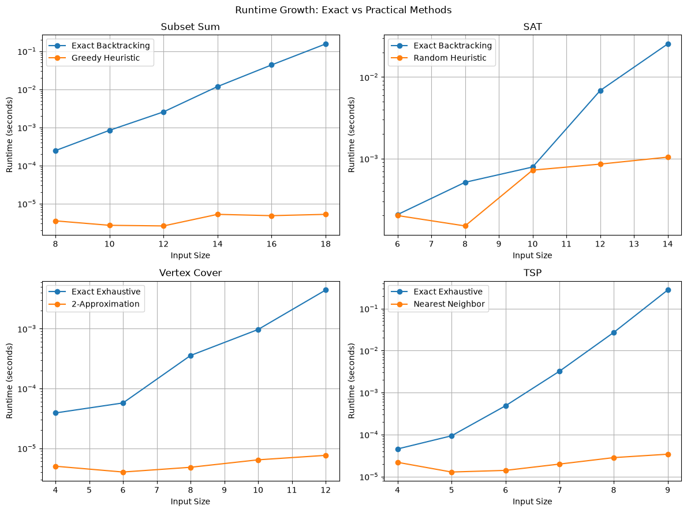
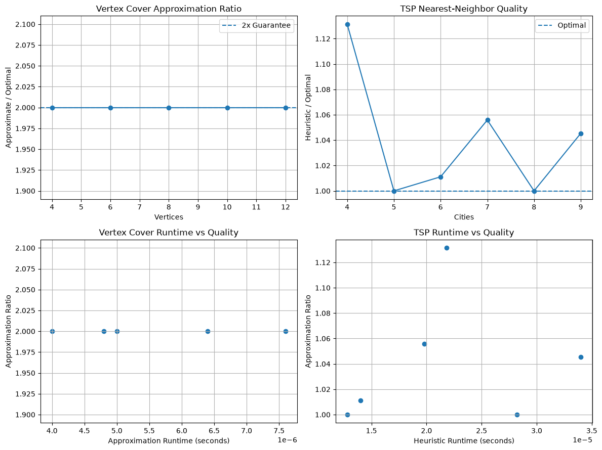

# Week 8 Computational Complexity and NP-Completeness Report

Jaymes McKenzie

## Executive Summary

Week 8 focused on computational complexity and what happens when problems become too expensive to solve exactly. The project implemented exact solutions for Subset Sum, SAT, Vertex Cover, and Traveling Salesman Problem instances, then compared them with heuristics or approximation algorithms.

The benchmark results showed a clear difference between exact exponential or exhaustive methods and faster practical approaches. The strongest example was Subset Sum. At an input size of 8, the exact backtracking solver visited 511 search nodes. At an input size of 18, it visited 524,287 nodes and required about 0.155 seconds. The greedy heuristic stayed near a few microseconds across all tested sizes.

The same pattern appeared in TSP. Exact exhaustive search took about 0.276 seconds for 9 cities, while the Nearest Neighbor heuristic took about 0.000034 seconds. The heuristic tour was only about 4.5% longer than the optimal tour for that case.

These results demonstrate why recognizing NP-complete and NP-hard problems matters. Exact solutions may be practical for small inputs, but approximation and heuristic methods often become necessary as input size increases.

## Methodology

The project was developed and benchmarked on Windows using Python 3.14.5. Pytest was used for automated testing, Pandas stored benchmark results, and Matplotlib generated the required charts.

Four problem areas were tested. Subset Sum used an exact include-or-exclude backtracking solver and a descending greedy heuristic. The benchmark deliberately selected targets larger than the total sum of all values. This forced the exact solver to explore the complete search tree and made exponential growth easier to observe.

SAT was tested using a DFS/backtracking solver and a random-assignment heuristic. The generated formulas were satisfiable 3-CNF instances. Runtime, search nodes, and heuristic success rate were measured as the number of variables increased.

Vertex Cover compared exhaustive optimal search against the standard 2-approximation algorithm. Cycle graphs with 4 through 12 vertices were used so exact and approximate solution sizes could be compared directly.

TSP compared exhaustive optimal tours with the Nearest Neighbor heuristic on reproducible random two-dimensional points. Exact search was limited to 9 cities because factorial growth quickly makes exhaustive TSP expensive.

## Results

### Subset Sum

Subset Sum provided the clearest example of exponential growth. The exact solver visited 511 nodes for an input of size 8, 2,047 nodes at size 10, 8,191 at size 12, and 32,767 at size 14. At sizes 16 and 18, this increased to 131,071 and 524,287 nodes.

Runtime followed the same pattern. The exact solver increased from about 0.000246 seconds at size 8 to about 0.154676 seconds at size 18. The greedy heuristic remained extremely fast, requiring only about 0.000005 seconds at size 18.

The difference comes from the search strategy. Exact backtracking may need to consider every possible subset, giving worst-case complexity of O(2^n). The greedy approach sorts the values and makes one pass through them, which is approximately O(n log n). However, the greedy method is not guaranteed to find a solution even when one exists.

This is an important trade-off. The exact algorithm provides correctness, while the heuristic provides speed.

### SAT

The SAT results showed a similar but less dramatic pattern. Exact backtracking took about 0.000205 seconds at 6 variables and increased to about 0.025453 seconds at 14 variables. Search nodes increased from 8 to 1,057 over the same range.

The random heuristic remained much faster on the larger cases. At 14 variables, it took about 0.001041 seconds. However, its success rate dropped as the problem became more difficult. The heuristic succeeded in every trial at 6 and 8 variables, but only one-third of the trials at 10, 12, and 14 variables.

This demonstrates why heuristics should not be confused with exact algorithms. The random method may produce a valid satisfying assignment quickly, but failure does not prove that the formula is unsatisfiable. The backtracking solver, on the other hand, can determine whether a solution exists.

### Vertex Cover

The Vertex Cover experiment compared exhaustive optimal search with the standard 2-approximation algorithm.

For every tested cycle graph, the approximation ratio was exactly 2.0. For example, at 12 vertices the optimal cover contained 6 vertices, while the approximation algorithm returned 12. This still satisfies the formal guarantee that the approximation solution is no more than twice the size of the optimal solution.

The performance difference became more noticeable as the graph grew. At 12 vertices, exhaustive search required about 0.004428 seconds, while the approximation algorithm required only about 0.0000076 seconds.

The cycle graphs used in this benchmark happen to produce the upper edge of the 2-approximation guarantee. This is useful because it demonstrates that an approximation guarantee is a bound, not a claim that the algorithm will normally return the optimal solution.

### Traveling Salesman Problem

TSP showed the strongest practical difference between exhaustive search and a heuristic.

At 4 cities, the exact solver required about 0.000045 seconds. By 9 cities, runtime increased to about 0.276 seconds. Nearest Neighbor remained extremely fast, requiring about 0.000034 seconds at 9 cities.

The quality of the heuristic remained relatively close to optimal in these test cases. The worst observed approximation ratio was about 1.131 at 4 cities, meaning the heuristic tour was about 13.1% longer than optimal. At 5 and 8 cities, Nearest Neighbor happened to find the optimal route. At 9 cities, its approximation ratio was about 1.045, or roughly 4.5% above optimal.

Unlike the Vertex Cover algorithm used in this project, Nearest Neighbor does not provide the same formal 2-approximation guarantee. Its value comes from speed and simplicity rather than a fixed worst-case ratio.

## Discussion

The experiments help explain the practical meaning of P, NP, NP-hard, and NP-complete problems. Problems in P have algorithms that run in polynomial time. NP contains decision problems whose proposed solutions can be verified in polynomial time. NP-complete problems are both in NP and at least as difficult as every other problem in NP under polynomial-time reductions.

No polynomial-time algorithm is currently known for NP-complete problems in general. This does not mean every individual instance is difficult. Small inputs or favorable instances may still be solved quickly. The problem appears when the input grows and the worst-case search space increases exponentially or factorially.

Polynomial-time reductions are important because they allow knowledge about one problem to transfer to another. The 3-SAT to Vertex Cover reduction implemented in this project showed how a Boolean formula can be transformed into a graph while preserving whether a solution exists. If an efficient general solution were found for the resulting NP-complete problem, it could be used to solve the original problem efficiently as well.

The benchmark results also show why approximation algorithms and heuristics are important. Vertex Cover provides a formal quality guarantee while avoiding exhaustive search. Nearest Neighbor TSP provides no comparable guarantee here, but it produced solutions close to optimal at a tiny fraction of the runtime.

These approaches are useful in real applications such as routing, scheduling, resource allocation, computational biology, and logistics. In those areas, waiting for an exact optimal solution may be less useful than receiving a good solution quickly.

## Conclusion

Week 8 demonstrated that algorithm design is not only about finding faster implementations. It is also about recognizing when the structure of a problem places limits on what can realistically be computed.

Subset Sum showed exponential search growth directly, while TSP demonstrated how factorial exhaustive search becomes expensive even at small sizes. SAT showed the difference between a reliable exact solver and a faster heuristic with uncertain success. Vertex Cover demonstrated how approximation algorithms can provide a mathematical quality guarantee while running far faster than exhaustive search.

The main lesson is that understanding complexity changes the way problems are approached. When exact polynomial-time solutions are unavailable, reductions help classify the problem, while approximation algorithms and heuristics provide practical alternatives. Knowing when to stop searching for the perfect solution and accept a useful one is an important part of algorithm design.

## References

Cormen, T. H., Leiserson, C. E., Rivest, R. L., & Stein, C. (2022). *Introduction to Algorithms* (4th ed.). MIT Press.

Amakobe, M. (2025). *Advanced Algorithms: Concepts, Complexity, and Applied Projects*. Chapter 7: Computational Complexity & NP-Completeness.

